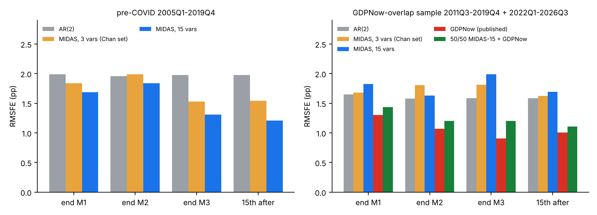

# A MIDAS complement to the GDPNow replication

**Proposal (one model):** a **real-time Ridge-MIDAS** nowcast of the BEA *advance* GDP estimate, refit at every forecast date on the data vintage actually published that day. It is a simplified Babii–Ghysels–Striaukas (2022) sg-LASSO-MIDAS, with Clements–Galvão (2008) real-time vintages, run on 15 monthly/weekly/daily indicators. Chan's three-variable set is run through the identical pipeline as an ablation.

Everything below was executed end to end (`midas/run_all.sh`; public data, no API key). **Update:** dropping the trade balance and modelling per-capita growth (section 3) removes the post-2021 failure at no pre-COVID cost; that is the variant I would carry forward. **Verdict: feasible and informative, not a GDPNow competitor.** Before COVID it beats AR(2) by about 40% at quarter-end. It is clearly worse than GDPNow, and it fails after 2021. Its one real use is as a minor (~25–35%) blend partner to GDPNow in 2011–19.

## 1. Literature in brief (what matters for this choice)

| Strand | Key papers | What it contributes here |
|---|---|---|
| MIDAS | Ghysels–Santa-Clara–Valkanov (2004/06); Foroni–Marcellino–Schumacher (2015, unrestricted MIDAS) | Regress quarterly GDP directly on lagged high-frequency data; linear lag polynomials make recursive re-estimation cheap |
| Real-time MIDAS | [Clements–Galvão (2008, JBES)](https://econpapers.repec.org/RePEc:bes:jnlbes:v:26:y:2008:p:546-554): monthly data on the current quarter significantly improves current-quarter output-growth forecasts; vintage-based variants in the 2007 working paper | Use the ALFRED vintage as of each forecast date, not today's revised data |
| High-dimensional MIDAS | [Babii–Ghysels–Striaukas (2022, JBES 40(3))](https://arxiv.org/pdf/2005.14057): sg-LASSO with orthogonal-polynomial (Legendre) lag dictionaries; reported to beat NY Fed nowcasts at some horizons | The lag-weight compression and shrinkage used here (ridge instead of sg-LASSO) |
| Time-varying MIDAS | Chan–Poon–Zhu (2025, J. Econometrics): TVP-MIDAS with SV; their 15-indicator version gains about 4pp of RMSFE over the 3-indicator one | The 3-variable ablation; time variation **not** implemented (needs MCMC, and the notes show the gain comes mostly after 2008) |
| Factor + sparse | Beyhum–Striaukas (2026, JBES) | Natural next extension (factor augmentation helps around COVID) |
| Operational benchmarks | Higgins (2014) GDPNow; NY Fed Staff Nowcast (Bok et al. 2018) | GDPNow's published track record is the yardstick |

Points on the three questions in the notes. (i) Time variation: not tested; it needs a different estimator. (ii) Information set: tested here as 3 vs 15 indicators. (iii) Real-time implementation: this is the part most worth copying from the literature, and it is done properly here.

## 2. The model

For each forecast origin O (end of months 1, 2, 3 of the quarter, and the 15th of the following month) and target quarter q:

1. **Data as of O.** ALFRED vintage dated O for each series and for GDP. The ragged edge is whatever had been released. Each series' lag `lag_s` is read off the vintage (e.g. payrolls trail by a month at end-M1).
2. **Training rows.** For every past quarter τ (1992Q3 onward, COVID quarters 2020–21 excluded) build the window that quarter's data would have shown *at the same point in its quarter* with the same publication lags. Each window is the last 6 monthly values, compressed to 3 numbers by a degree-2 orthonormal Legendre polynomial (level / slope / curvature of the lag weights). Weekly and daily series are averaged to months and count as available only if the month is essentially complete.
3. **Ridge.** y_τ = GDP growth (annualised, from the same vintage), regressors = 15 × 3 polynomial features + lagged GDP growth. Standardised, ridge penalty chosen by leave-one-out CV at every origin (closed form, via SVD).
4. Benchmarks on the identical vintage and training window: AR(2); the 3-variable MIDAS (INDPRO, NFCI, 10y–3m spread); published GDPNow at the same dates.

**Predictors (15).** Labour: payrolls, unemployment rate, mfg hours, jobless claims. Production: IP, durable orders. Spending: retail sales, PCE (both nominal), Michigan sentiment. Housing starts. Trade balance. Business inventories. CPI. Financial: NFCI, 10y–3m spread.

**Target.** BEA advance estimate. Pre-2011 it is the first RTDSM vintage; this reproduces Atlanta Fed's BEA advance figures to 0.002pp over all 60 overlapping quarters (checked). 2011Q3 onward uses the Atlanta Fed file. 78 scored quarters, 2005Q1–2026Q3 (8 of them COVID), 349 forecast dates.

## 3. Results

RMSFE in pp (annualised), against the advance estimate. Full tables, DM tests: `midas/results/tables_nominal.md`.

| Origin | AR(2) | MIDAS-3 (Chan set) | **MIDAS-15** |
|---|---|---|---|
| **2005–19 (60 qtrs)** | | | |
| end M1 | 1.99 | 1.84 | 1.69 |
| end M2 | 1.96 | 1.99 | 1.84 |
| end M3 | 1.98 | 1.53 | **1.31** |
| 15th after | 1.98 | 1.54 | **1.21** |
| **2022Q1–2026Q3 (19 qtrs)** | | | |
| end M1 / M2 / M3 / 15th | 1.99 / 1.98 / 1.97 / 1.97 | 1.96 / 2.41 / 2.61 / 2.21 | 2.18 / 2.04 / **2.98** / 2.42 |
| **COVID 2020–21 (8 qtrs)** | | | |
| end M3 | 19.15 | 8.62 | 4.90 |

Against GDPNow (same dates, 53 quarters 2011Q3–19Q4 and 2022–26Q3):

| Origin | AR(2) | MIDAS-15 | **GDPNow** | 50/50 blend |
|---|---|---|---|---|
| end M1 | 1.65 | 1.83 | **1.30** | 1.44 |
| end M2 | 1.58 | 1.63 | **1.07** | 1.20 |
| end M3 | 1.58 | 1.99 | **0.90** | 1.20 |
| 15th after | 1.58 | 1.69 | **1.01** | 1.11 |

What this says, plainly:

- **Information set matters pre-COVID.** 15 variables beat AR(2) by about 34% at end-M3 and about 39% on the 15th after (DM p = 0.03 and 0.02). The 3-variable set gets about two-thirds of that gain at end-M3 (1.53); 15 vs 3 variables is suggestive only (DM p = 0.15 at end-M3, 0.01 on the 15th after; 60 quarters). This agrees with the published Chan et al. direction (about 4pp better with more indicators).
- **GDPNow is much better.** Even on 2011–19 alone, GDPNow 0.79 vs MIDAS-15 1.09 at end-M3. GDPNow's explicit consumption/investment/inventory/net-trade accounting is worth far more than a 15-variable regression, which supports the notes' view that the gap is GDP accounting and source data, not estimator sophistication.
- **It fails after 2021.** 2.98 vs AR(2) 1.97 at end-M3, driven by two quarters: 2022Q2 (predicted +8.0, actual −0.9) and 2025Q2 (predicted +8.9, actual +3.0). Both are extreme trade-balance swings that the linear model extrapolates; GDPNow models net trade directly and was within 0.1.
- **A small complementary role.** In 2011–19 the errors are only moderately correlated (0.2–0.6) and a 25–35% MIDAS weight lowers GDPNow's RMSFE: end-M3 0.79 → 0.72, 15th after 0.72 → 0.64. After 2021 the best weight is 0–10% (`results/complement.txt`). The weights are chosen in-sample, so treat the gain as an upper bound.

### Specification honesty
The headline is the specification I fixed first (nominal predictors, no clipping). After seeing the 2022+ failure I tried two fixes, deflating the nominal flows by CPI and winsorising standardised predictors at ±3 SD. Neither solves it (`compare_specs.py`, end-M3 MIDAS-15 RMSFE):

| Variant | 2005–19 | 2022–26 |
|---|---|---|
| nominal (headline) | 1.31 | 2.98 |
| CPI-deflated | 1.39 | 2.81 |
| winsorised | 1.49 | 2.68 |
| both | 1.51 | 2.49 |
| **drop trade balance** | **1.34** | **2.03** |

CPI-deflating and winsorising cost pre-COVID accuracy and still leave 2022+ above AR(2) (1.97). **Dropping the trade balance** (suggested after the diagnosis above) is the only fix that is nearly free: 2005–19 is unchanged (1.34 vs 1.31; 1.19 vs 1.21 on the 15th after) and 2022–26 falls to AR(2) level (2.03). On the GDPNow-overlap sample end-M3 improves from 1.99 to 1.49, still well short of GDPNow's 0.90. The 2022Q2 miss shrinks from +8.0 to +2.7 against an actual of −0.9, and 2025Q2 from +8.9 to +2.2 against +3.0. Its live 2026Q4 nowcast is 3.68% instead of 4.29%. It is still a post-hoc choice, so the cleanest next step is to confirm it on data after 2026Q3, and it means the model carries no net-trade information at all, which is exactly where GDPNow has its edge. Because I looked at the 2022+ errors to choose these variants, they are not clean out-of-sample tests.

### Intercept and per-capita version
The intercept is the training-sample mean of GDP growth (ridge leaves it unpenalised), with every quarter since 1992Q3 weighted equally. It therefore lags trend changes. By 2019 it was about 2.6%, and the model over-predicted by about 0.6pp on average in both samples. To address this I model **GDP growth minus population growth** and add the population assumption back (trailing 4-quarter growth of monthly total population, ALFRED vintage as of each forecast date). The same adjustment is applied to the AR(2) benchmark, so the comparison stays fair. Variant `nominal_notrade_pc`, RMSFE (end M1 / M2 / M3 / 15th after):

| | no trade, GDP growth | **no trade, per capita** | AR(2) per capita | GDPNow |
|---|---|---|---|---|
| 2005–19 | 1.73 / 1.66 / 1.34 / 1.19 | **1.65 / 1.56 / 1.25 / 1.10** | 1.96 / 1.93 / 1.94 / 1.93 | n/a |
| 2022–26 | 2.06 / 1.81 / 2.03 / 2.05 | **1.99 / 1.65 / 1.82 / 1.83** | 1.92 / 1.89 / 1.86 / 1.86 | n/a |
| GDPNow overlap | 1.72 / 1.46 / 1.49 / 1.47 | **1.65 / 1.30 / 1.33 / 1.30** | 1.59 / 1.55 / 1.51 / 1.51 | 1.30 / 1.07 / 0.90 / 1.01 |

Every cell improves. The end-of-quarter mean error falls from +0.58 to +0.24pp (2005–19) and from +0.81 to +0.24pp (2022–26). The intercept implied for 2026Q4 is now 1.95% plus 0.24% population growth, against about 2.7% before. The live 2026Q4 nowcast becomes **2.84%** (MIDAS-3: 2.51%, AR(2): 2.32%; GDPNow 3.22%). The gap to GDPNow at end-of-quarter is still large (1.33 vs 0.90). Residual bias is probably the productivity slowdown, which per-capita adjustment does not remove. A rolling-window or trend-adjusted intercept is the natural next test. This was also chosen after seeing earlier results (`results/percapita.txt`).

### Blend with GDPNow, final (per-capita, no trade) specification
Best in-sample MIDAS weight, and RMSFE of GDPNow alone vs the blend (end M1 / M2 / M3 / 15th after). 2011Q3–2019Q4: weights 50 / 45 / 35 / 35%, GDPNow 1.06 / 1.00 / 0.79 / 0.72 to blend 0.93 / 0.89 / 0.73 / 0.63. 2022Q1–2026Q3: weights 0 / 25 / 10 / 30%, GDPNow 1.51 / 1.19 / 1.08 / 1.38 to blend 1.51 / 1.13 / 1.06 / 1.27. This supersedes the 25–35% figures above, which were for the nominal-GDP-growth spec.

## 3b. The tracker page
`docs/midas.html` (next to the GDPNow tracker) shows the final specification (per-capita, trade balance dropped) as two tabs: MIDAS with 14 indicators and MIDAS with 3 indicators. Each has a Data tab (headline, GDPNow comparison, waterfall of what changed since a chosen date, daily evolution, contribution by indicator) and a Replication tab (method, accuracy, track record, blend with GDPNow, how the specification was chosen). `midas/live.py` runs the model for any date (the workflow `midas-daily.yml` runs it each weekday), `midas/build_page_data.py` builds the static tables and `midas/make_page.py` assembles the HTML. Backfilled daily history starts 2026-04-01.

## 4. Live nowcast
2026Q4 as of 2026-10-31 (end of month 1): **MIDAS-15 4.29%**, MIDAS-3 3.12%, AR(2) 2.70%; GDPNow 3.22% (Oct 29). The largest contribution (+0.6pp) is the trade balance, the same channel that failed in 2022Q2 and 2025Q2, so I would not trust this number. The replication's own chained 2026Q4 nowcast (3.26%) is the better guide.

## 5. Caveats
- Predictor *history* comes from the vintage at O (revised), and only the edge is real-time; targets are advance estimates. This is Clements–Galvão's "end-of-sample vintage" approach.
- Jobless claims (before 2009) and NFCI (before 2011) have no ALFRED vintages, so the current series cut at O is used (pseudo-real-time). The Oct-2025 unemployment and CPI holes (shutdown) are interpolated.
- Missing from the panel: ISM surveys, real PCE, construction, imports/exports detail. All of these are in or behind GDPNow.
- Only 50–110 training quarters; early evaluation years rely on 55 observations for 46 features.
- No time variation, no stochastic volatility, no density forecasts.

## 6. Recommendation
Use MIDAS as a **diagnostic complement**, not a second headline nowcast. In practice: (a) quote it as a "data-only" cross-check against the replication, (b) if you extend it, the highest-value step is the fix for the failure above, i.e. add a net-exports/inventory component (bridge) block or robust loss, before adding TVP. With the same code you can add the NY Fed DFM or a factor-augmented variant (Beyhum–Striaukas) on identical vintages.

Files: `midas/` (`nowcast.py` model, `fetch_vintages.py`, `build_targets.py`, `analysis.py`, `compare_specs.py`, `run_all.sh`), results in `midas/results/` (forecasts for every origin, tables, figures).
